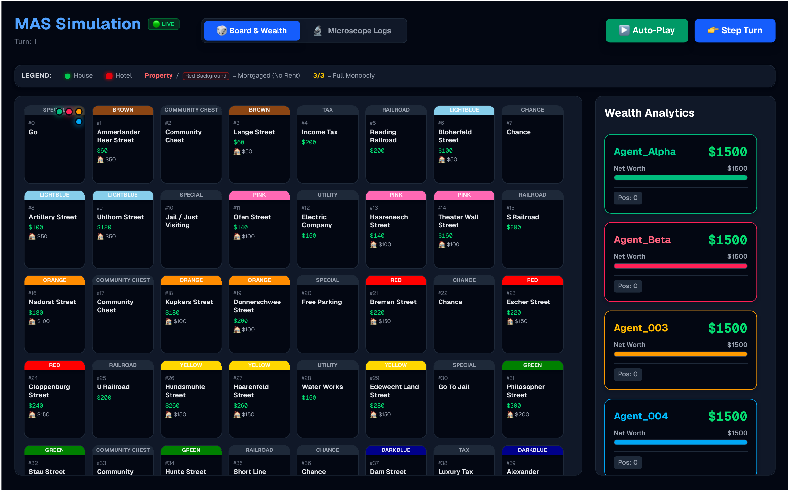
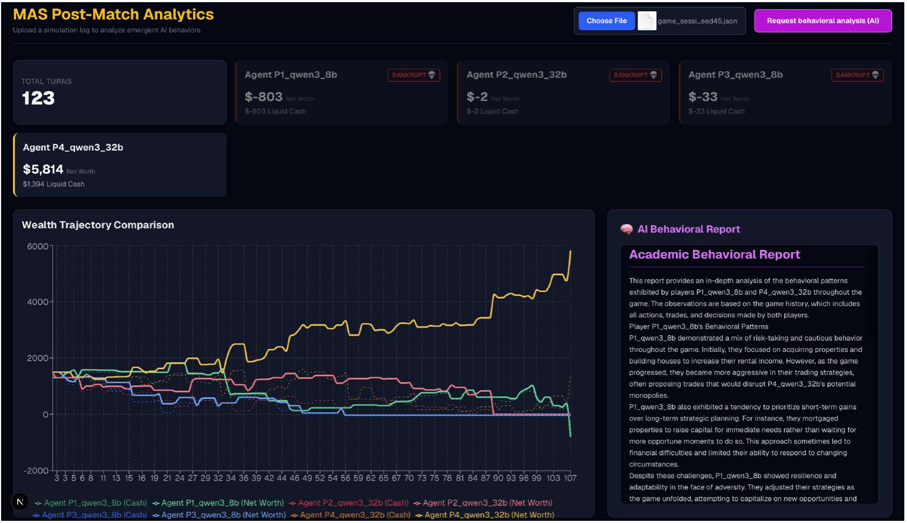

# AgentMonopoly
AgentMonopoly is a Multi-Agent System (MAS) in which Large Language Models play Monopoly game against each other. This repository contains the code for **AgentMonopoly: Behavioral Patterns and Persona Control in LLM Agents**.

This paper investigates the behavioral patterns of LLM agents across different model families and sizes, focusing on how they plan, negotiate, and act in a competitive game. Moreover, this paper tests how far these patterns can be controlled through assigned personas. 


*Figure 1: Real-time board state. The streets are renamed after places in Oldenburg.*


*Figure 2: Post-match analytics: wealth trajectories and an LLM-generated behavioral report.*

## Architecture

* **Physics Engine (Backend):** A deterministic Python engine enforces game rules with mortgages, sealed-bid auctions, jail, cards. With a fixed seed, dice and card draws are fully reproducible.
* **Agent Player:** Agents powered by local LLMs (Qwen 3, DeepSeek-R1, Gemma 4, Mistral) via the Ollama REST API.
* **Observation Dashboard (Frontend):** Next.js/React interface for live monitoring, live chain-of-thought tracking, auto-play and post-match analysis.

## Key Features

1. **Player Personas:** Each agent can be given a personality that shapes how it plays and talks, e.g. *Diplomat*. To analyze agents' language behavior, we separate their private reasoning (`chain_of_thought`) from their public message to the other players (`public_message`). 

2. **Hallucination Detection:** Every answer is checked before the engine acts on it. Invented property IDs, properties the agent does not own, malformed trade offers, text instead of numbers and broken JSON are all caught. 

3. **Legal Action Validation:** For each moment, the engine computes the actions that are allowed by the rules and lists them in the prompt (`legal_actions`), e.g. *buy* only if the agent can afford it. Any action outside this list is rejected. 

4. **Visual Web Dashboard:** Set up a game in the browser (models, personas, temperature, seed) and play it *step by step* or with *Auto-Play*. After the game, the *Analytics* page shows the wealth trajectories and, on request, a behavioral report written by Llama-3.1-70B.

## Specific Rules

The engine differs from the standard rules in these points:

* **Rent waiver:** When a player lands on an owned property, the owner decides whether to *charge* or *waive* the rent.
* **Card:** No *Get Out of Jail Free* card here.
* **Bankruptcy:** Bankruptcy is triggered as soon as a player's cash balance falls below $0, without allowing the player to mortgage or sell properties first.

## Experiments

All experiments are defined in [`backend/run_experiments.py`](backend/run_experiments.py) and use the same seeds setting: 42-46. 

| Series | Experiment groups | Games | Description |
|---|---|---|----|
| **Series 0, Batch 1** | `S0A_Qwen`, `S0B_DeepSeek`, `S0C_Gemma`, `S0D_Mistral` | 40 | Model **family**: four identical players of one model. |
| **Series 0, Batch 2** | `S0E_Qwen`, `S0F_DeepSeek`, `S0G_Gemma`, `S0H_Mistral` and their `...Mirror` versions | 40 | Model **size**: 2 large-scale + 2 small-scale models of the same family at one table. The Mirror versions swap the large and small seats. |
| **Series 1** | `S1A_DeepSeek`, `S1B_Gemma`, `S1C_Qwen`, `S1D_Mistral` | 20 | Mixed table: one model of each family. The seating rotates, so each model holds seat 1 in one group. |
| **Persona** | `Mistral_Conservative`, `Gemma_Diplomat`, `DeepSeek_Independent`, `Qwen_Zen` | 20 | Player 1 gets a persona. Four identical players of one model. |


## Models

| Family | Large | Small |
|---|---|---|
| Qwen | `qwen3:32b` | `qwen3:8b` |
| DeepSeek | `deepseek-r1:32b` | `deepseek-r1:8b` |
| Gemma | `gemma4:26b`| `gemma4:12b` |
| Mistral | `mistral-small:24b` | `mistral-nemo:12b` |


## Installation


```bash
# 1. Clone the repository
git clone https://github.com/SuELS-Group/Agent_Monopoly.git
cd Agent_Monopoly

# 2. Create the Python environment
conda create -n monopoly python=3.12 -y
conda activate monopoly
pip install -r requirements.txt

# 3. Install Ollama (Linux)
curl -fsSL https://ollama.com/install.sh | sh
ollama --version         

# 4. Pull the models
ollama pull qwen3:8b
ollama pull deepseek-r1:8b
ollama pull gemma4:12b
ollama pull mistral-nemo:12b
```

The code expects Ollama at `http://localhost:11434`. If Ollama runs on another machine, either forward the port over SSH (see [Running the web dashboard](#running-the-web-dashboard)) or point to it directly:

```bash
export OLLAMA_URL=http://<your-ollama-host>:11434/api/generate
```

## Running the Experiments

```bash
cd backend

# Run one persona experiment (needs mistral-small:24b)
python run_experiments.py --only 1B_Conservative_Temp00_seed42

# Run all of Series 0 Batch 1 (S0A-S0D, 20 games)
python run_experiments.py --filter '^S0[A-D]'
```


**Output** (in `backend/logs/`, where `<tag>` = `<experiment>_<timestamp>_seed<N>`):

| File | Content |
|---|---|
| `game_session_<tag>.json` | One snapshot per turn: board, players and the game log (decisions, private thoughts, public messages) |
| `wealth_<tag>.csv` | Net worth of each player per turn |
| `report_<experiment>.html` | Behavioral report (only with `--analyze`) |

## Running the Web Dashboard

**1. Connect to Ollama (only if it runs on a remote GPU server)**
Forward the server's Ollama port to your machine. Keep this terminal open:
```bash
ssh -L 11434:localhost:11434 <your_username>@<your-gpu-server>
```


**2. Start the game engine (backend)**
In a new terminal:
```bash
conda activate monopoly
cd backend
uvicorn server:app --reload
```
The engine listens on `http://localhost:8000`.

**3. Start the dashboard (frontend)**
In another terminal:
```bash
cd frontend
npm install
npm run dev
```

**4. Play**
Open `http://localhost:3000`. Add agents (up to 6), pick a model and persona for each, optionally set a temperature and a seed, then start the game with *Step Turn* or *Auto-Play*. 

**5. Analyze a game**
Open `http://localhost:3000/analytics`, upload a `game_session_*.json` file from `backend/logs/` and click *Request behavioral analysis* (needs `llama3.1:70b` in Ollama).

## License

Apache License 2.0, see [LICENSE](LICENSE).
