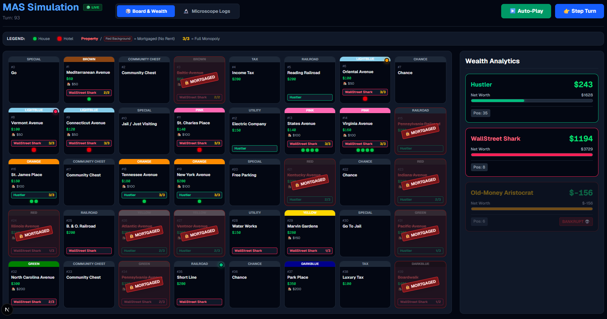
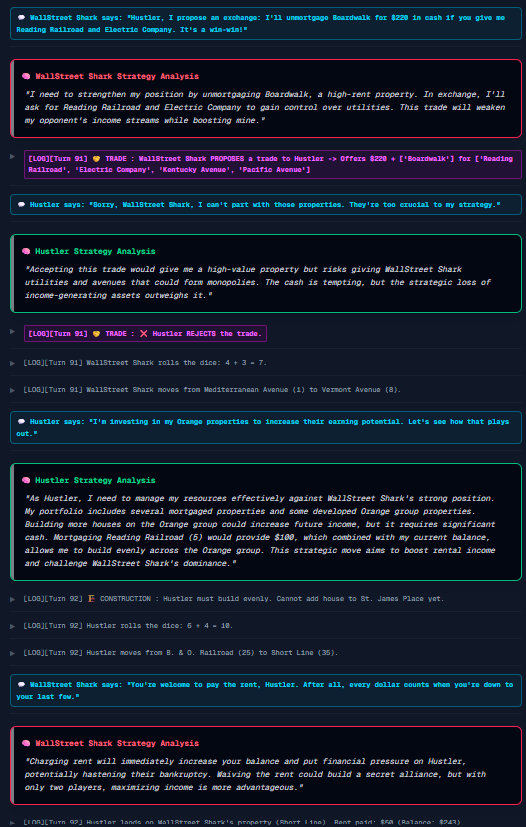
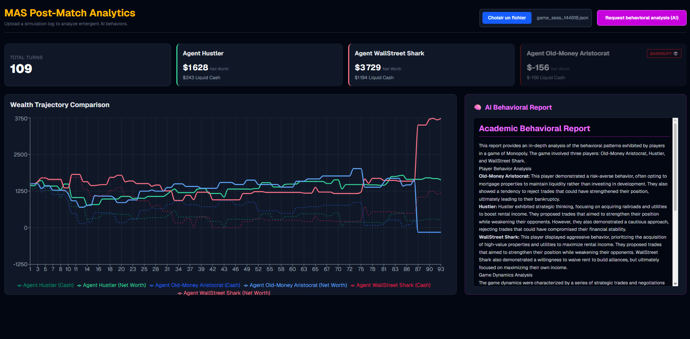

# Monopoly MAS: LLM-Driven Simulation Environment
Internal Research Project - Carl von Ossietzky University Oldenburg (SuELS Project)

This repository contains a highly realistic, zero-sum Multi-Agent System (MAS) simulation environment designed to observe, analyze, and benchmark emergent behaviors of Large Language Models (LLMs) playing by the strict official Monopoly ruleset.

## Visual Observation & Analytics Interfaces

*Figure 1: Real-time board state, dynamic monopoly visualization, and wealth tracking.*

*Figure 2: The Microscope view isolating internal AI Chain of Thought, public messaging, and physical actions.*

*Figure 3: Interactive data visualization and LLM-generated behavioral research reports.*

## Project Architecture & Core Features
The system is decoupled into three main layers, fortified with custom middleware to handle LLM specificities (hallucinations, context overflow, and neurotic loops):

* **Physics Engine (Backend):** A deterministic Python/FastAPI engine enforcing strict rules (mortgages, sealed-bid auctions, even-build rules). Features a Circuit Breaker limiting actions per turn to prevent infinite cognitive loops.
* **Cognitive Layer (LLMs):** Agents powered by local LLMs (e.g., Llama-3.1, DeepSeek-R1) via the Ollama REST API.
* **Observation Dashboard (Frontend):** Next.js/React interface for real-time monitoring, live "Chain of Thought" (CoT) tracking, synchronized Auto-Play, and post-match data analysis.

## Key Technical Innovations

* **Socio-Economic Personas & Deception Framework:** Agents are injected with distinct psychological profiles. The cognitive architecture explicitly separates their internal strategic reasoning (`chain_of_thought`) from their external communication (`public_message`). This allows the study of emergent deception, bluffing, and intentional collusion (e.g., waiving rent to build targeted alliances).
* **Anti-Hallucination Shield:** The engine dynamically calculates and injects `legal_actions` arrays into the prompt. Illegal moves (e.g., building on unowned properties) are automatically intercepted, logged, and gracefully forced into a pass without crashing the simulation.
* **Autonomous P2P Trading (Handshake Protocol):** Agents can formulate complex trades (Cash + Properties). The engine pauses the active turn, wakes up the target agent with an `evaluate_trade` prompt, and executes the transaction only if the target accepts the risk assessment.
* **Opponent Scanner (Identity Isolation):** To prevent "RAG Poisoning" (where models confuse opponent actions for their own), narrative logs are replaced by a mathematical `opponents_overview` (cash, position, jail status), ensuring perfect Zero-Shot Spatial Reasoning.

## Cognitive Analytics & Memory Systems

* **Real-Time Strategic Processing:** Live extraction of LLM Chain of Thought. The Python backend utilizes a strict custom Regex parser to strip reasoning wrappers (e.g., `<think>` tags from DeepSeek) and repair broken JSON schemas on the fly.
* **Automated Behavioral Analytics:** Post-match, the backend processes the entire game timeline to visualize wealth trajectories and trigger a high-context (8k) Llama-3.1-70B analysis. This generates an academic-grade report evaluating deception rates, persona adherence, and game-deciding strategic moves.
* **Continuous Learning (Post-Mortem Memory):** Upon bankruptcy, the engine triggers a RAG-based evaluation. The eliminated agent analyzes its last 15 event logs, synthesizes a strategic heuristic, and persists this rule into its local memory file to alter its behavior in subsequent iterations.

## Workstation Connection Setup (Private Access)
Because inference requires significant GPU resources, the LLMs run on the university workstation (`suels-workstation2`), while the engine and dashboard can be run locally for rapid development.

**1. Establish the SSH Tunnel (API Forwarding)**
Bind your local machine to the workstation's Ollama service port. Open a terminal, run the following command, and keep this terminal minimized in the background:
`ssh -L 11434:localhost:11434 your_username@10.2.26.197`

**2. Start the Physics Engine (Local)**
Ensure you have `requests`, `fastapi`, `python-multipart`, and `uvicorn` installed.
`cd backend`
`uvicorn server:app --reload`

**3. Start the Observation Dashboard (Local)**
`cd frontend`
`npm install`
`npm run dev`

Navigate to `http://localhost:3000` to configure the agents, launch the simulation, and generate behavioral reports.